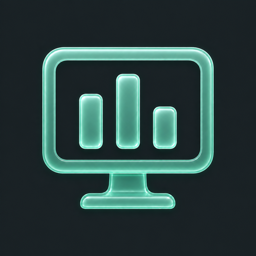
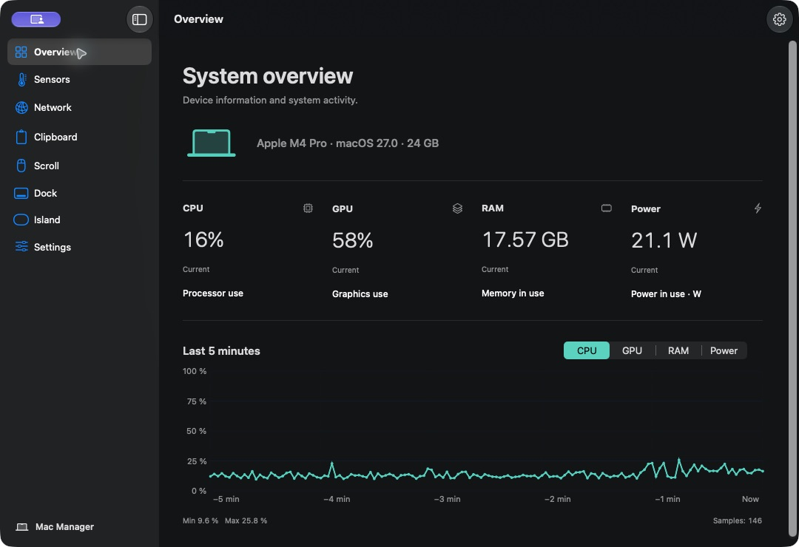

<p align="center">
  
</p>

<h1 align="center">Mac Manager</h1>

<p align="center">
  <strong>Know your Mac. Keep your flow.</strong><br>
  Live system insights, a private clipboard, a keyboard-first launcher<br>
  and your media at the top of the screen. One native Mac app.
</p>

<p align="center">
  
  
  
  <a href="LICENSE"></a>
</p>

<p align="center">
  
  
  
  
  
  
  
  
  
</p>

<p align="center">
  
</p>

<p align="center"><sub>Actual Mac Manager interface on Apple Silicon. Captured from an isolated development build with live local hardware readings.</sub></p>

## Your Mac, at a glance

See what your Mac is doing without opening a collection of separate utilities.

- **Follow the load.** Live CPU, GPU and RAM readings, plus an estimated power reading when supported.
- **See the trend.** Five-minute charts with a choice of 1, 2 or 5 second sampling. Gaps stay visible when readings stop.
- **Check the hardware.** CPU/GPU temperatures in °C or °F and individual fan speeds. Temperature mapping is currently validated on M4 Pro.
- **Keep essentials in sight.** Choose the readings shown in the menu bar and open the compact panel for a quick check.
- **Find your connection.** View and copy your local and public IPv4 addresses, with optional visibility in the menu bar panel.

Sensor support depends on the Mac model. Power is an AppleSMC estimate, and unavailable readings are clearly marked. Fans are monitored in read-only mode.

## Less searching. More doing.

Press **Option-Q** and start typing. Open an app, find a file, jump to a Mac Manager section or work out a calculation from the same floating launcher.

| What you need | What you can do |
| :--- | :--- |
| An application | Use fuzzy search, aliases, favorites and custom shortcuts. |
| A file or folder | Search names through Spotlight within folders you choose. |
| A quick answer | Calculate `20% of 500`, convert `10 km to mi` or evaluate `tomorrow + 2 days`. |
| Something you copied | Press **Tab** to search the shared clipboard history. |

Arrow keys select, **Enter** opens or copies, and **Escape** clears the query before closing. The shortcut is configurable, and the launcher remains available with the main window closed. Calculator keywords use English syntax; calculations run locally.

## Copy once. Find it again.

Keep useful text and images within reach, with search, previews and restore in the main window, launcher and top-edge island. All three use the same history.

- **Choose what stays.** Pause capture, exclude applications and set limits for age, item count and storage.
- **Keep it on your Mac.** Text, images and previews are encrypted locally with AES-GCM; the key is protected by Secure Enclave.
- **Pick up where you left off.** Restore an entry, then paste with **Command-V** in your destination app.

The default limits are **50 items, 7 days and 200 MB**. History is enabled on a fresh install, but capture waits for permanent macOS clipboard permission granted through **Check access**. Existing clipboard content is not imported when capture starts. Marked confidential entries are skipped; application exclusions give you further control.

## A little space at the top. A lot within reach.

Move to the notch area to open a native **Liquid Glass** island. On a display without a notch, it lives at the center of the top edge. The collapsed state shows no content.

**Clipboard** gives you a horizontal shelf of recent copies with previews and search. **Apple Music** brings artwork, track information, progress and playback controls into the panel. **Apple Podcasts** adds episode information, play/pause and the player's own skip intervals, with artwork from its existing local cache after you grant folder access.

Choose the sections you want in the dedicated Island settings. Hover leaves your current app's keyboard focus intact; deliberate keyboard interaction lets you search and navigate. Transitions respect Reduce Motion, and hidden media sections stop periodic reads.

Apple Music requires Automation permission. Podcasts requires Accessibility permission and an available player window. Spotify integration is not available yet.

## Your mouse, your way

Reverse mouse scrolling vertically and horizontally while keeping your trackpad direction, gestures and momentum intact. Automatic source classification handles the switch between mouse and trackpad without model lists or per-device profiles.

Enable the feature in **Scroll**, then grant the Accessibility and Input Monitoring permissions shown there.

## Built to live with your Mac

A persistent menu bar, optional Dock icon and launch at login keep the app available throughout the day. Close the main window and continue using the launcher and island.

Background work adapts to the system's Low Power Mode and to which readings are actually visible. Shared hardware sessions, event-driven network updates and on-demand clipboard loading reduce repeated work. Clipboard content and thumbnails share a **16 MB data cache**; this is a cache budget, not a limit on total app memory.

The interface supports **Polish and English**, with an immediate language switch, a dark main workspace and native Liquid Glass controls.

## Private by design

**No accounts. No ads. No telemetry. No application-managed cloud sync.**

Clipboard history, preferences and searches stay local. Locking the session clears private previews and the clipboard data cache. Diagnostics are local and shown before you choose to copy a report.

Public IPv4 discovery contacts **ipify**, and release checks contact **GitHub**. Those services see the request's source IP. Both features have controls in the app; system metrics, clipboard contents and launcher queries are not sent to them. Media controls communicate with local players, which have their own network activity.

## Build and run

**Requirements:** an Apple Silicon Mac, **macOS 26+** and **Xcode 26+** selected through `xcode-select`.

The source is available under AGPL-3.0-only. A public signed, notarized DMG has not been released yet.

```sh
git clone https://github.com/MrDeex1k/MacManager.git
cd MacManager
open MacManager.xcodeproj
```

Select the shared **MacManager** scheme and run on **My Mac**. No project generator or third-party package installation is needed.

<details>
<summary><strong>Build from Terminal</strong></summary>

```sh
xcodebuild -project MacManager.xcodeproj -scheme MacManager \
  -configuration Debug -destination 'platform=macOS,arch=arm64' \
  -derivedDataPath /tmp/macmanager-app-build build

open /tmp/macmanager-app-build/Build/Products/Debug/MacManager.app
```

Local builds use the **Mac Manager Dev** identity and separate preferences and macOS permissions. A development build is not a notarized distribution artifact.

</details>

| Shortcut | Action |
| :--- | :--- |
| **Option-Q** | Open the launcher; configurable in Settings. |
| **Tab** | Switch between application search and clipboard search in the launcher. |
| **Command-1** / **Command-2** | Open Overview / Network. |
| **Command-,** | Open Settings. |
| **Option-1…4** | Select an enabled island section while interacting with the island. |

## Under the hood

**Swift 6, native UI and shared services.** SwiftUI and AppKit present the same application state across the window, menu bar, launcher and island. A local Swift package separates domain logic from platform adapters, with actors for hardware reads, storage, search and calculation.

| Area | Technology |
| :--- | :--- |
| Interface | SwiftUI, AppKit, Observation, Swift Charts, Liquid Glass |
| Hardware and input | C adapters, Mach, IOKit, AppleSMC, Quartz event taps |
| Local data | SQLite, CryptoKit AES-GCM, Secure Enclave, Keychain |
| Search and integration | Spotlight, LaunchServices, Apple Events, Accessibility, SMAppService |
| Verification | Swift Testing, XCTest UI, isolated fixtures and opt-in system integrations |

Selected launcher and calculator mechanisms are adapted from Tinycast. Scroll Reverser, Stats and Unicode components retain their respective notices. See [third-party attributions](THIRD_PARTY_NOTICES.md).

## Make it yours

[Build Mac Manager](#build-and-run), choose your menu bar readings and configure the tools you use every day.

Have an idea or a reproducible bug? [Open an issue](https://github.com/MrDeex1k/MacManager/issues). Want to contribute? Read [CONTRIBUTING.md](CONTRIBUTING.md). Report security concerns privately through [SECURITY.md](SECURITY.md).

Mac Manager is available under [GNU AGPL v3.0 only](LICENSE). Official releases will always remain free.
